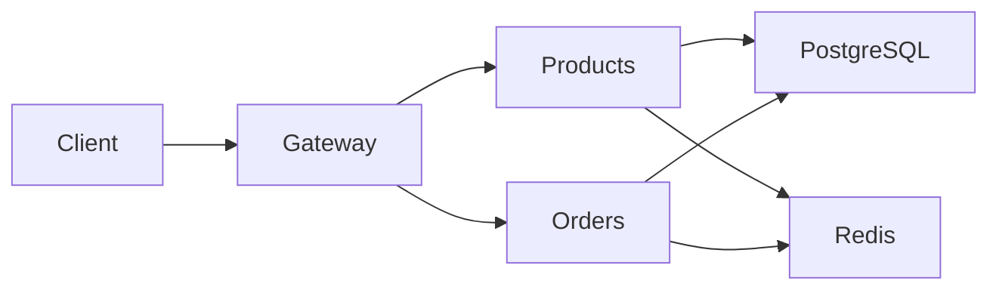
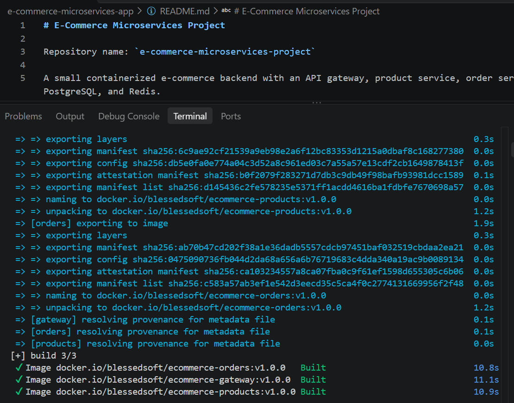
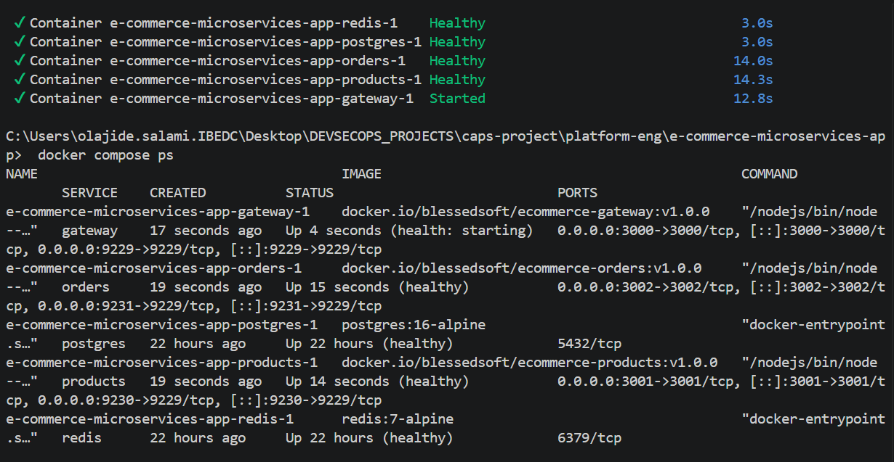
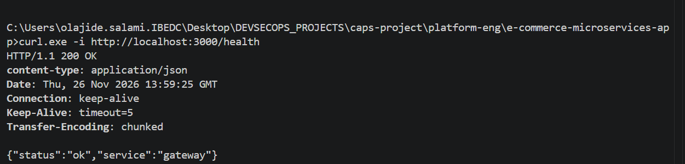
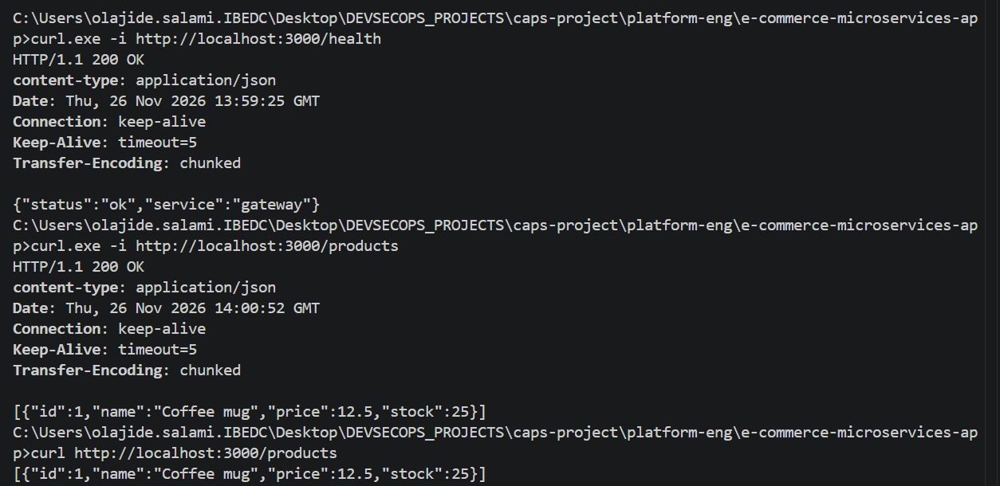
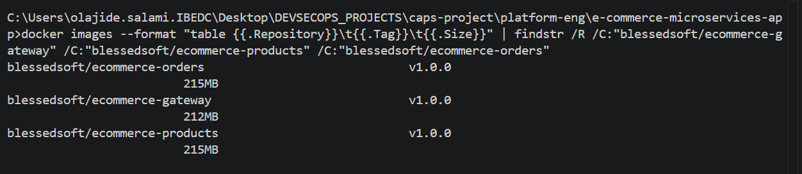
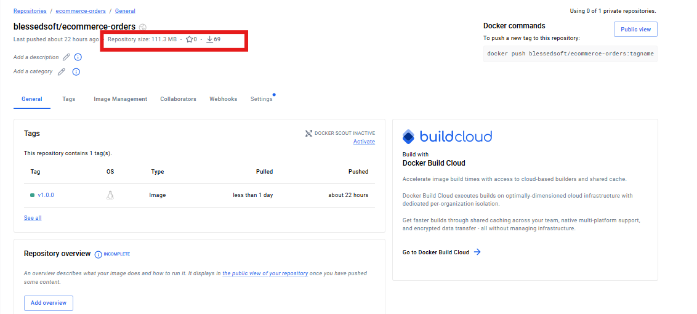
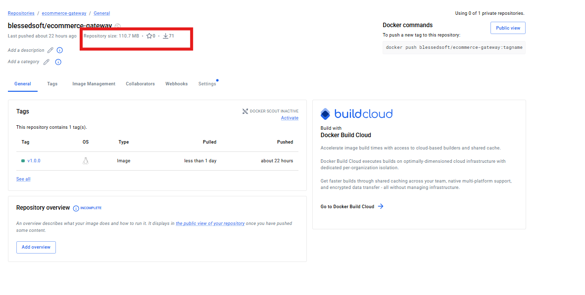
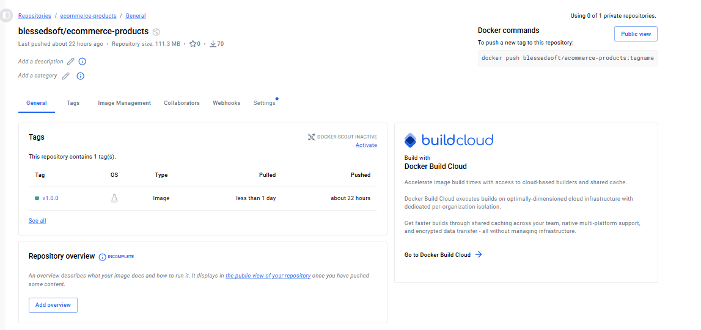
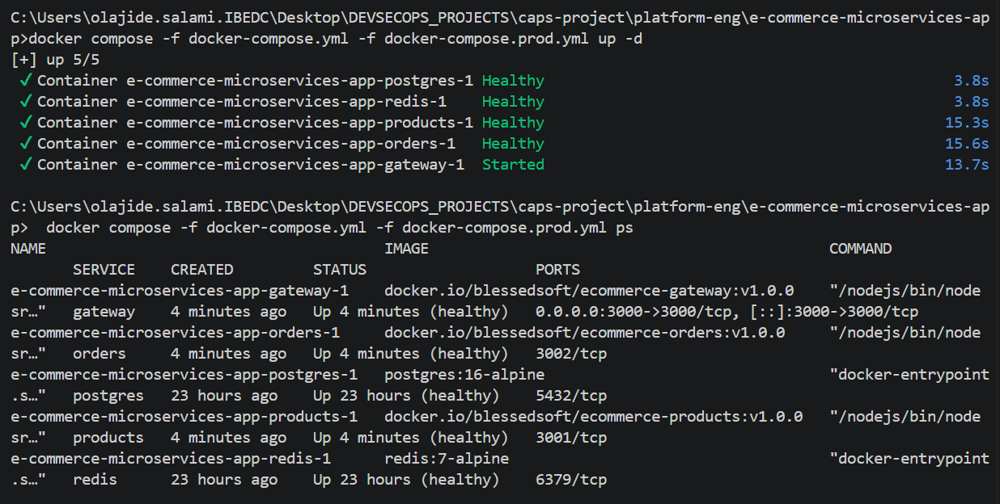

# E-Commerce Microservices Project

Repository name: `e-commerce-microservices-project`

A small containerized e-commerce backend with an API gateway, product service, order service, PostgreSQL, and Redis.



```
.
├── .dockerignore
├── .env
├── .env.example
├── .gitignore
├── docker-compose.override.yml
├── docker-compose.prod.yml
├── docker-compose.yml
├── package.json
├── README.md
└── services
    ├── gateway
    │   ├── .dockerignore
    │   ├── Dockerfile
    │   ├── package.json
    │   └── src
    │       └── server.js
    │
    ├── orders
    │   ├── .dockerignore
    │   ├── Dockerfile
    │   ├── package.json
    │   └── src
    │       └── server.js
    │
    └── products
        ├── .dockerignore
        ├── Dockerfile
        ├── package.json
        └── src
            └── server.js
```

## Run locally

Docker Compose reads `.env` if present. Start from the example without committing your real password:

```sh
cp .env.example .env
docker compose up --build
```

The gateway is available at `http://localhost:3000`.

```sh
curl http://localhost:3000/products
curl -X POST http://localhost:3000/orders \
  -H 'content-type: application/json' \
  -d '{"productId":1,"quantity":2}'
```

Development mode is automatic when using the base file: `docker-compose.override.yml` mounts source code and exposes service/debug ports. Persistent PostgreSQL and Redis data is stored in named volumes.

## Production images

Set `REGISTRY` to the Docker Hub namespace (or another registry), then build and push the semantic version tag:

```sh
docker login
docker compose build
docker compose push
REGISTRY=docker.io/your-user VERSION=v1.0.0 docker compose -f docker-compose.yml -f docker-compose.prod.yml up -d
```

The production file references registry images and does not build application images. Keep credentials in the environment or a secret manager; they are never copied into an image.

## Design and security notes

- Each application image uses a dependency-first multi-stage Alpine build and runs as the non-root `node` user.
- Every application and infrastructure container has a health check; application startup waits for healthy PostgreSQL/Redis and upstream services.
- Configuration is provided through environment variables. Change the example database password before deployment.
- Compose places services on a dedicated network, applies CPU/memory limits, and uses named persistent volumes.
- The application handles `SIGTERM` for graceful shutdown.

## Image size report

The final sizes depend on the local Docker cache and image version. The report below defines the required result; record the measured value after building:

| Image | Runtime base | Required maximum | Measured |
|---|---|---:|---:|
| `ecommerce-gateway` | `gcr.io/distroless/nodejs22-debian13:nonroot` | 150 MB | see evidence below |
| `ecommerce-products` | `gcr.io/distroless/nodejs22-debian13:nonroot` | 150 MB | see evidence below |
| `ecommerce-orders` | `gcr.io/distroless/nodejs22-debian13:nonroot` | 150 MB | see evidence below |

```sh
docker compose build
docker images --format 'table {{.Repository}}\t{{.Tag}}\t{{.Size}}' \
  | Select-String 'ecommerce-(gateway|products|orders)'
```

The three application Dockerfiles use the official `gcr.io/distroless/nodejs22-debian13:nonroot` runtime. The build stages use Alpine only for dependency installation; the final images contain only production dependencies and application source. Distroless images do not include a shell or `wget`, so application health checks use the Node runtime directly.

Docker Hub displays compressed layer sizes, while `docker images` displays local unpacked image sizes. Record both measurements when documenting the 150 MB requirement:

```sh
docker images --format 'table {{.Repository}}\t{{.Tag}}\t{{.Size}}' \
  | Select-String 'ecommerce-(gateway|products|orders)'
docker buildx imagetools inspect docker.io/blessedsoft/ecommerce-gateway:v1.0.0
docker buildx imagetools inspect docker.io/blessedsoft/ecommerce-products:v1.0.0
docker buildx imagetools inspect docker.io/blessedsoft/ecommerce-orders:v1.0.0
```

## Submission evidence

The `evidences/` directory contains screenshots supporting the assignment requirements.

### Build and runtime validation

The application images build successfully, all Compose services report healthy, and the gateway/API endpoints respond successfully:



*Figure 1: Successful multi-service Docker build.*



*Figure 2: Gateway, products, orders, PostgreSQL, and Redis running with healthy status.*



*Figure 3: Gateway health check returning HTTP 200.*



*Figure 4: Products retrieval and order creation API responses.*

### Image size and registry evidence

The following evidence shows the local Docker image-size output and the published Docker Hub image pages. Local Docker sizes are unpacked sizes; Docker Hub reports compressed registry sizes.



*Figure 5: Local unpacked image-size output.*



*Figure 6: Published orders image and registry size.*



*Figure 7: Published gateway image and registry size.*



*Figure 8: Published products image and registry size.*

### Production deployment



*Figure 9: Production Compose deployment using the `docker.io/blessedsoft` registry images and semantic `v1.0.0` tags.*
